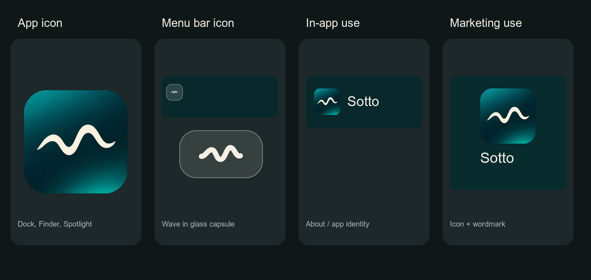
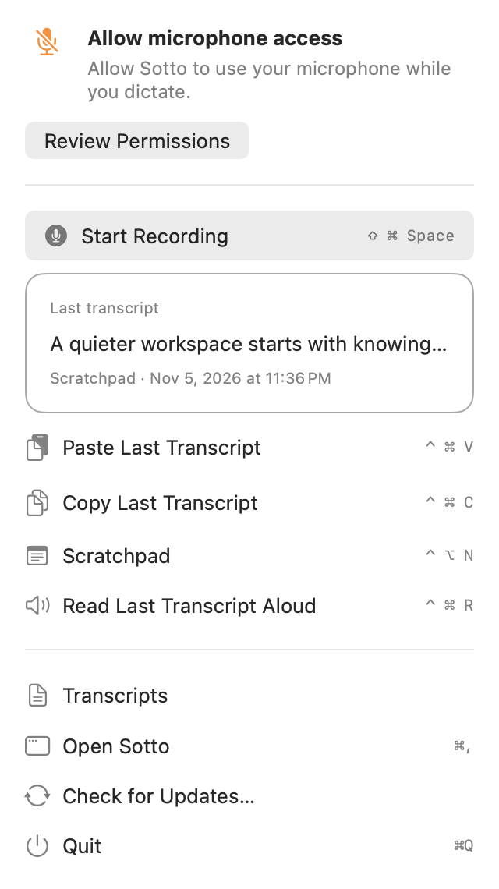
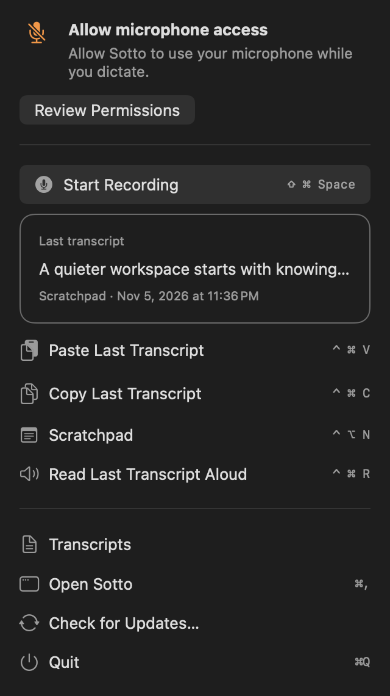
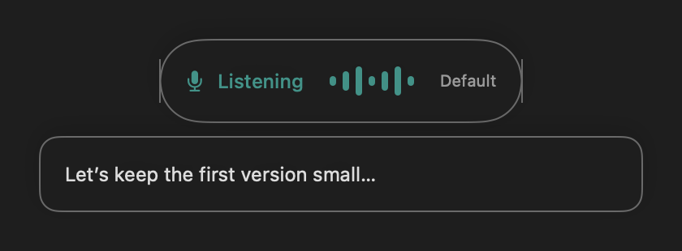
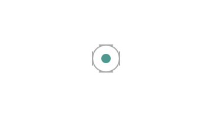
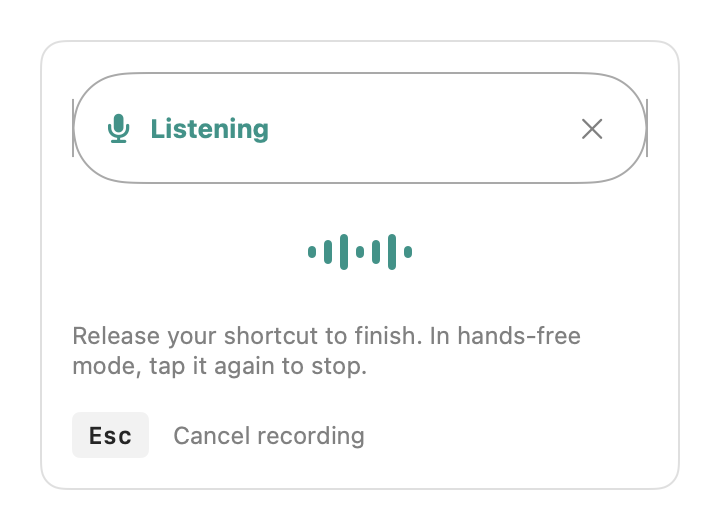

# Sotto

[](LICENSE)

Sotto is a native macOS app for voice dictation. Press a shortcut, speak, and paste a transcript into the app where you are working. Speech recognition and text cleanup run on your Mac. Sotto has no account, hosted inference, API keys, analytics, or telemetry.

The only network requests are for model files you choose to download and Sparkle update checks. Your audio, transcripts, vocabulary, clipboard contents, and screen context are not uploaded. Read the [privacy details](PRIVACY.md).



The Soft Wave app icon identifies Sotto in the Dock and Finder. Its wave also appears inside a glass bubble in the menu bar. The in-app and marketing panels above show intended brand use; they are mockups, not additional screens.

## The interface

The menu bar popover puts recording, the last transcript, and transcript actions together. Start Recording is the primary action; Paste, Copy, Scratchpad, and Read Aloud stay secondary. Status and shortcuts use the same visual rules as the main window.

| Light appearance | Dark appearance |
|---|---|
|  |  |

These are captures of the popover view in a test window with sample transcript text and microphone permission unavailable. The menu bar icon is shown in the brand image above. See [brand assets and capture notes](docs/media/brand/README.md).

In **Settings → General → Recording Indicator Style**, choose the bottom capsule with a caret dot, a dot beside your writing, or a floating window. The dot-only style follows the active caret or pointer while you dictate. The capsule and floating window appear on the display containing the focused writing window.

| Bottom capsule | Dot near writing | Floating window |
|---|---|---|
|  |  |  |

These are captures of Sotto's SwiftUI views with sample text and audio levels. They contain no recording or personal text.

## Get started

Sotto runs on an Apple silicon Mac with **macOS 14 or later**. To build it, use **macOS 15.6 or later** with Xcode 26, its Metal toolchain, and XcodeGen. The build does not require an Apple Developer account.

Download `Sotto.zip` from [GitHub Releases](https://github.com/divingsbysangam/sotto/releases), unzip it, and move `Sotto.app` to `/Applications`. The published v2.0 download predates the interface and icon updates shown above; build from current source to use them. The self-signed release has not been notarized by Apple. On first launch, Control-click the app and choose **Open**, then confirm **Open**. Later launches work normally. Verify the checksum in the release notes before installing.

To build from source:

```bash
git clone https://github.com/divingsbysangam/sotto.git
cd sotto
brew install xcodegen
xcodebuild -downloadComponent MetalToolchain
./scripts/build.sh
./scripts/build.sh test
```

The build-only script generates the Xcode project, then builds without signing or installing. For a stable local signature that preserves macOS permission grants across rebuilds, run `./scripts/create-signing-cert.sh` once and then `./scripts/build-and-install.sh`. See [SETUP.md](SETUP.md) for the full setup and troubleshooting guide.

## Dictation and local models

Whisper Large v3 Turbo is Sotto's speech engine. It supports language detection, non-English speech, translation fallback, and live preview. Text cleanup uses Apple Foundation Models on supported Macs or built-in rules.

| Model | Download | Use |
|---|---:|---|
| Whisper Large v3 Turbo | About 1.6 GB | Dictation and imports |

The model download is pinned by revision and SHA-256. After installation, dictation works offline. See [third-party notices](THIRD_PARTY_NOTICES.md) for model sources and licenses.

## Permissions

Sotto asks only for permissions needed by features you use:

| macOS permission | Why Sotto needs it |
|---|---|
| Microphone | Record your voice for dictation |
| Accessibility | Paste into the focused app and find the text caret |
| Screen Recording | Read optional on-screen context with local OCR |
| Input Monitoring | Count typing activity for the optional Voice vs Keyboard statistic; key contents are never recorded |
| Apple Events | Optionally pause Music or Spotify while recording |

You can review or revoke these in **System Settings → Privacy & Security**. Permission-gated features stop when their permission is unavailable; other features keep working. [PRIVACY.md](PRIVACY.md) explains storage, retention, and network behavior.

## Frequently asked questions

**Does Sotto send recordings to a server?** No. Recognition and cleanup run on your Mac. Model downloads and update checks are the only network uses.

**Why is the first download large?** Whisper is a local model, so Sotto downloads its files once instead of sending speech to a hosted service.

**Why does macOS ask for permissions again after a rebuild?** macOS associates grants with the app's signature and bundle ID. Use the stable self-signed identity and install script in [SETUP.md](SETUP.md). The first public build uses a new bundle ID, so existing private builds need fresh grants once.

**Can I build without installing?** Yes. `./scripts/build.sh` builds without signing or touching `/Applications`.

**Does Sotto work on Intel Macs?** No. The local MLX dependencies require Apple silicon.

## Project and credits

Sotto is built with SwiftUI, WhisperKit, Sparkle, and HotKey. The model authors and converters are credited in [THIRD_PARTY_NOTICES.md](THIRD_PARTY_NOTICES.md). See [docs/ARCHITECTURE.md](docs/ARCHITECTURE.md) for the code structure, [CONTRIBUTING.md](CONTRIBUTING.md) to help, and [SECURITY.md](SECURITY.md) to report a vulnerability privately.

Sotto's own source is [MIT licensed](LICENSE). Dependencies and downloaded models retain their own licenses.
